# Caravana 77 — todas as telas do sistema

Catálogo completo das rotas declaradas em [src/App.tsx](src/App.tsx), conferido em 22/10/2026. As variantes com namespace e as rotas legadas são indicadas separadamente. Modais e painéis internos aparecem depois do catálogo. Implementação de uma tela não equivale à liberação de produção.

**Ambiente de demonstração homologado:** [caravana77-staging.pages.dev](https://caravana77-staging.pages.dev), Firebase `bdall-e3585`, frontend `bc5dd40`. Use somente dados fictícios. O [relatório da rodada](docs/MASTER_EXECUTION_2026-10-22.md) registra testes, versões e pendências reais.

## Navegação por perfil

| Perfil | Entrada | Espaço disponível |
|---|---|---|
| Visitante | `/` ou `/o/:tenantSlug` | Catálogo, viagem e formulário de inscrição |
| Passageiro | `/conta/entrar` | Conta, inscrições próprias e convites; portal exige acesso válido |
| Equipe operacional | `/admin/login` | Operação da organização autorizada, conforme permissões |
| Responsável da organização | `/admin/login` | Operação, identidade, documentos, contrato, equipe e suporte |
| Platform Owner | `/platform/login` | Onboarding assistido e administração global; não concede acesso automático aos dados privados dos tenants |

`:tenantSlug` identifica a organizadora; `:slug`, a viagem; `:id`, a caravana ou inscrição conforme a rota. IDs e links privados de passageiros reais não fazem parte deste README.

## Telas públicas e do passageiro

| # | Tela | Rota | Conteúdo e comportamento | Referência visual |
|---|---|---|---|---|
| 01 | Apresentação comercial | `/saas` | Recursos, diferenciais Essencial/Pro/Premium, preços, implantação, FAQ e contato configurado | [Landing](#landing-comercial) |
| 02 | Catálogo geral | `/` | Caravanas públicas, disponibilidade e entrada na área da equipe | [Catálogo](#catalogo-e-viagem) |
| 03 | Catálogo da organizadora | `/o/:tenantSlug` | Identidade e caravanas da organização resolvida pelo namespace | [Catálogo](#catalogo-e-viagem) |
| 04 | Detalhes da viagem | `/o/:tenantSlug/caravana/:slug` | Evento, horários, embarque, preço, vagas, orientações, regras e FAQ | [Viagem](#catalogo-e-viagem) |
| 05 | Detalhes da viagem — link legado | `/caravana/:slug` | Variante compatível da mesma tela, sujeita à resolução e isolamento do legado | Mesma composição da tela04 |
| 06 | Inscrição | `/o/:tenantSlug/caravana/:slug/inscricao` | Dados do passageiro, contato, ponto de embarque, consentimentos e reserva idempotente | [Formulário](#inscricao-e-portal) |
| 07 | Inscrição — link legado | `/caravana/:slug/inscricao` | Variante legada do formulário | Mesma composição da tela06 |
| 08 | Portal privado da inscrição | `/o/:tenantSlug/minha-inscricao/:id` | Situação da inscrição, viagem, comprovante, autorização de menor e instruções | [Portal histórico sintético](#inscricao-e-portal) |
| 09 | Portal — link legado | `/minha-inscricao/:id` | Variante legada do portal; identidade e acesso válidos continuam obrigatórios | Mesma composição da tela08 |
| 10 | Login do passageiro | `/conta/entrar` | Autenticação da conta cadastrada | Mesma base visual do login, com contexto do passageiro |
| 11 | Conta do passageiro | `/conta` | Perfil, inscrições vinculadas, acesso aos próprios convites e saída | [Componente](src/App.tsx) `PassengerAccount` |
| 12 | Meus convites | `/conta/convites` | UID próprio, convites recebidos, validade e aceite explícito | [Componente](src/InvitationInbox.tsx) |

O site registra informações e comprovantes; pagamentos e orientações de cobrança acontecem fora da plataforma. Nenhuma tela realiza transferência bancária ou conciliação automática.

## Telas da organização

| # | Tela | Rota | Conteúdo e comportamento | Referência visual |
|---|---|---|---|---|
| 13 | Login da equipe | `/admin/login` | E-mail/senha e entrada no espaço autorizado | [Login](#login-e-operacao) |
| 14 | Visão geral | `/admin` | Indicadores, caravanas e inscrições recentes; seletor da organização autorizada | [Painel](#login-e-operacao) |
| 15 | Caravanas | `/admin/caravanas` | Listagem, criação/edição, publicação/arquivamento e acesso à operação | [Caravanas](#login-e-operacao) |
| 16 | Passageiros da caravana | `/admin/caravanas/:id/passageiros` | Busca/filtros, inscrição, edição, situação, documentos, CSV e histórico | [Passageiros](#passageiros-financeiro-e-embarque) |
| 17 | Financeiro Geral | `/admin/financeiro` | Tudo/caravana, pagamentos informados, pendências, despesas e histórico auditado | [Financeiro](#passageiros-financeiro-e-embarque) |
| 18 | Financeiro da caravana | `/admin/caravanas/:id/financeiro` | Mesma tela com contexto da viagem selecionada | Mesma composição da tela17 |
| 19 | Comprovantes | `/admin/comprovantes` | Inscrições filtradas para conferência e análise manual de comprovantes | [Comprovantes](#passageiros-financeiro-e-embarque) |
| 20 | Check-in / Embarque | `/admin/check-in` | Seleção da caravana, progresso de embarque, busca e ponto de embarque | [Embarque](#passageiros-financeiro-e-embarque) |
| 21 | Check-in da caravana | `/admin/check-in/:id` | Mesma tela em contexto da caravana, com histórico operacional | Mesma composição da tela20 |
| 22 | Identidade pública | `/admin/identidade` | Nome, cor, imagem, contatos e mensagens públicas da organizadora | [Identidade](#configuracao-e-acessos) |
| 23 | Documentos e prazos | `/admin/documentos` | Prazos para próximos envios, conferência de vencimento e exclusão controlada por ação do responsável | [Documentos](#configuracao-e-acessos) |
| 24 | Plano e limites | `/admin/plano` | Contrato, situação, uso, limites e recursos concedidos; restrito ao responsável | [Plano](#configuracao-e-acessos) |
| 25 | Equipe e convites | `/admin/equipe` | Convites por UID, papéis, revogação, validade e auditoria; aceite obrigatório | [Equipe](#configuracao-e-acessos) |
| 26 | Suporte autorizado | `/admin/suporte` | Autorização temporária de consulta de configuração por operador, revogação e histórico | [Suporte](#configuracao-e-acessos) |
| 27 | Central de relatórios | `/admin/relatorios` | Pro/Premium: gerar, salvar, compartilhar e exportar CSV de resumo operacional; histórico preservado após downgrade | [Relatórios](#relatorios-roteiros-e-diagnostico) |
| 28 | Roteiros da equipe | `/admin/roteiros` | Premium: tarefas por caravana, modelos reutilizáveis, revisões, arquivamento e histórico | [Roteiros](#relatorios-roteiros-e-diagnostico) |
| 29 | Diagnóstico local | `/admin/diagnostico` | Até50 falhas sanitizadas da aba, exportação manual e limpeza; sem envio automático | [Diagnóstico](#relatorios-roteiros-e-diagnostico) |

As ações dependem de papel, organização, situação e entitlements. O seletor de organização não permite acesso a outro tenant sem autorização. Financeiro, documentos, CSV, equipe e identidade pertencem ao CORE já concedido; histórico e segurança não são removidos por downgrade.

## Administração da plataforma e estados comuns

| # | Tela | Rota / entrada | Conteúdo |
|---|---|---|---|
| 30 | Login da plataforma | `/platform/login` | Login no contexto global; exige conta com permissão específica |
| 31 | Organizadoras / Platform Owner | `/platform` | Cadastro assistido com UID existente conferido, plano, identidade, contadores, situação e auditoria; inclui console de suporte autorizado |
| 32 | Página não encontrada | `*` | Mensagem para endereço inexistente e retorno ao início |

Existem ainda estados de carregamento, organização/caravana/inscrição indisponível, conta sem autorização, organização suspensa, acesso negado e erro recuperável. Eles não criam rotas adicionais. A barreira global de erro oferece recarregamento e orienta consultar o histórico antes de repetir uma operação.

## Modais, abas e painéis dentro das telas

| Tela principal | Subtelas e ações |
|---|---|
| Caravanas | Nova caravana/edição, pontos e horários, descrição, regras, FAQ, orientações, publicação e arquivamento |
| Passageiros | Nova inscrição manual, editar inscrição, cancelar, revogar portal, filtros por situação/embarque, análise do comprovante, histórico operacional e autorização de menor |
| Importação CSV em Passageiros | Seleção/validação do arquivo, prévia de linhas, confirmação, resultado por linha, repetição das não confirmadas, histórico de lotes e rollback auditado |
| Financeiro | Registrar pagamento informado, histórico por passageiro, anulação com motivo, despesas e histórico financeiro; preserva eventos anteriores |
| Portal | Comprovante privado, envio/substituição conforme política, autorização do responsável por menor e situação da conferência |
| Equipe / Convites | Emitir/reemitir/revogar convite, aceitar convite próprio, alterar papel/situação com motivo; proteção do último responsável |
| Plano | Uso e limites por contrato, recursos cumulativos, bloqueio de crescimento e leitura do histórico preservado |
| Relatórios | Filtros por período, geração, histórico salvo, compartilhamento autorizado e exportação CSV |
| Roteiros | Criar roteiro/modelo, aplicar modelo, marcar/desmarcar tarefa, arquivar/reabrir, controle de revisão e eventos imutáveis |
| Plataforma | Onboarding assistido, alteração de situação, contrato e console de suporte somente após concessão do responsável |

## Galeria

As capturas de22/10 usam somente fixtures do staging e a candidata `bc5dd40`. Capturas históricas de16–20/10 estão identificadas abaixo; ilustram telas existentes, sem representar uma nova homologação. Há32 padrões de rota; variantes que compartilham a mesma tela não exigem imagens duplicadas. O catálogo cobre todas as rotas; a galeria é parcial. Conta/convites/plataforma e telas sem captura válida são documentadas por rota e código. Revisão documental consolidada em23/10/2026.

### Landing comercial

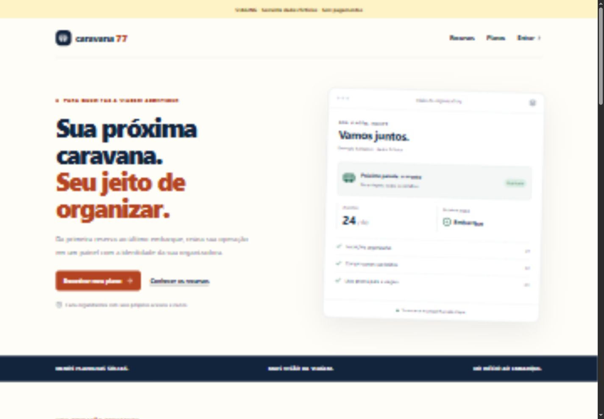

### Catálogo e viagem

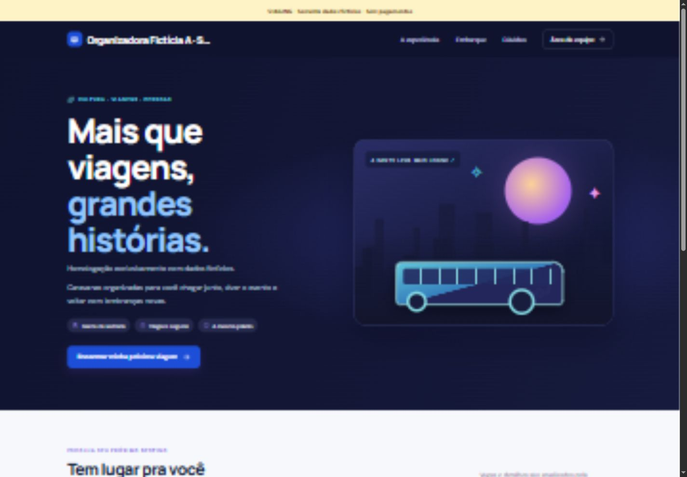

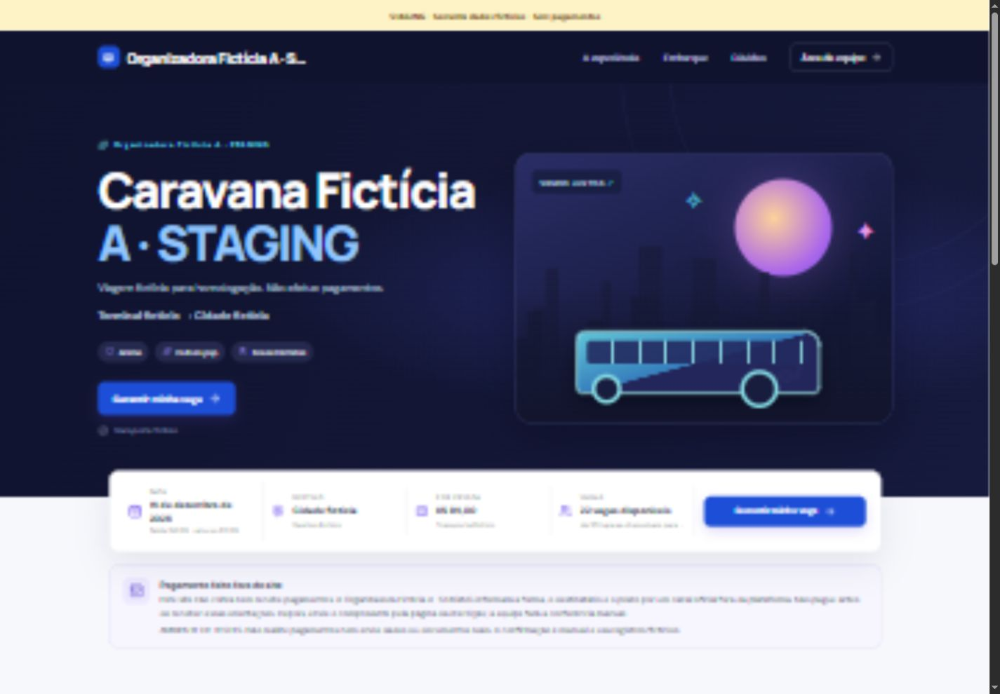

### Inscrição e portal

Formulário implementado em [RegistrationPage](src/App.tsx), com dados, embarque e consentimentos. Sem captura nova válida do formulário nesta rodada.

Portal privado, captura sintética histórica de16/10:

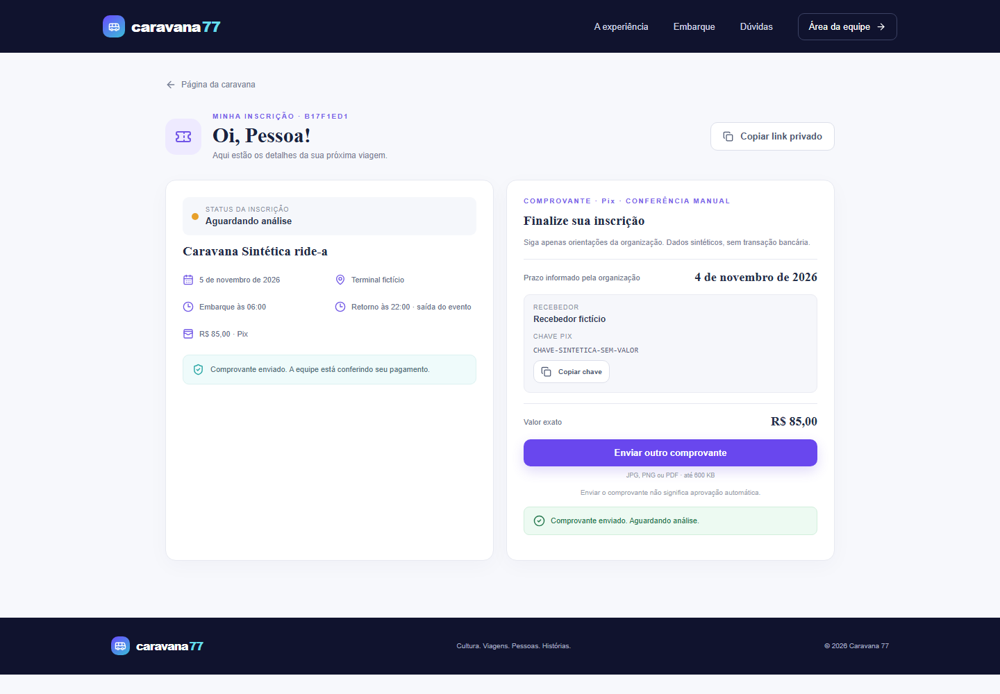

### Login e operação

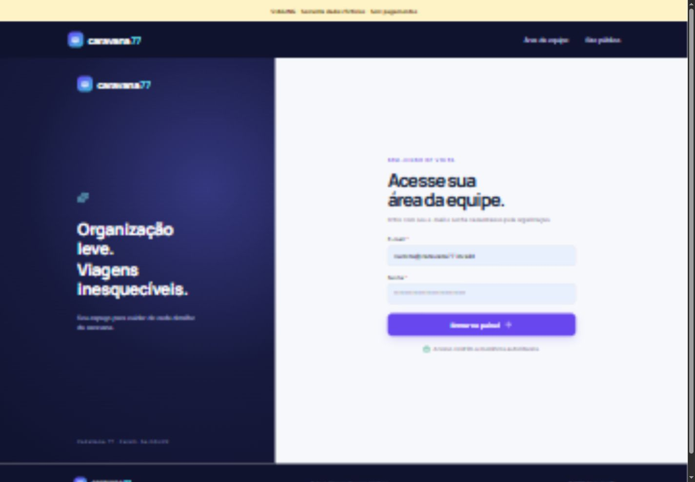

Visão geral: [AdminDashboard](src/App.tsx). A captura nova foi descartada porque mostrava carregamento.

Caravanas: [AdminCaravans](src/App.tsx). Cadastro, edição e arquivamento estão na mesma rota.

### Passageiros, financeiro e embarque

Passageiros: [Passengers](src/App.tsx). Listagem, filtros, importação e edição compartilham a rota.

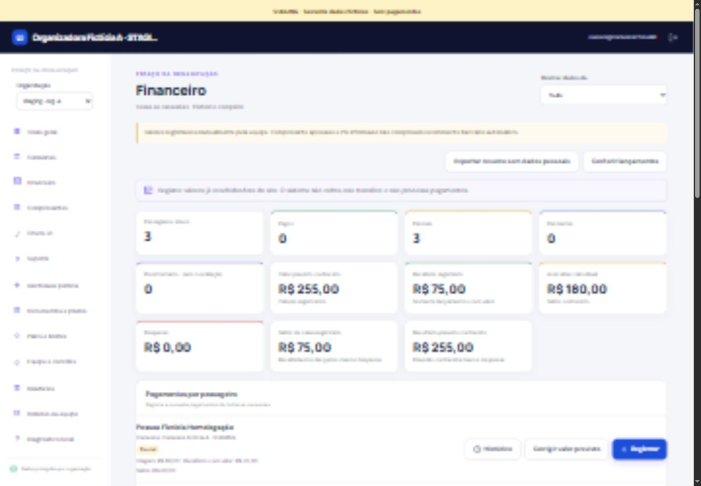

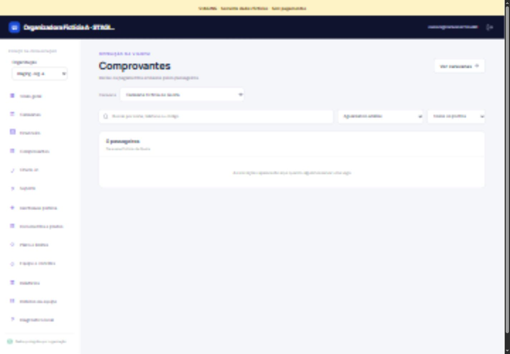

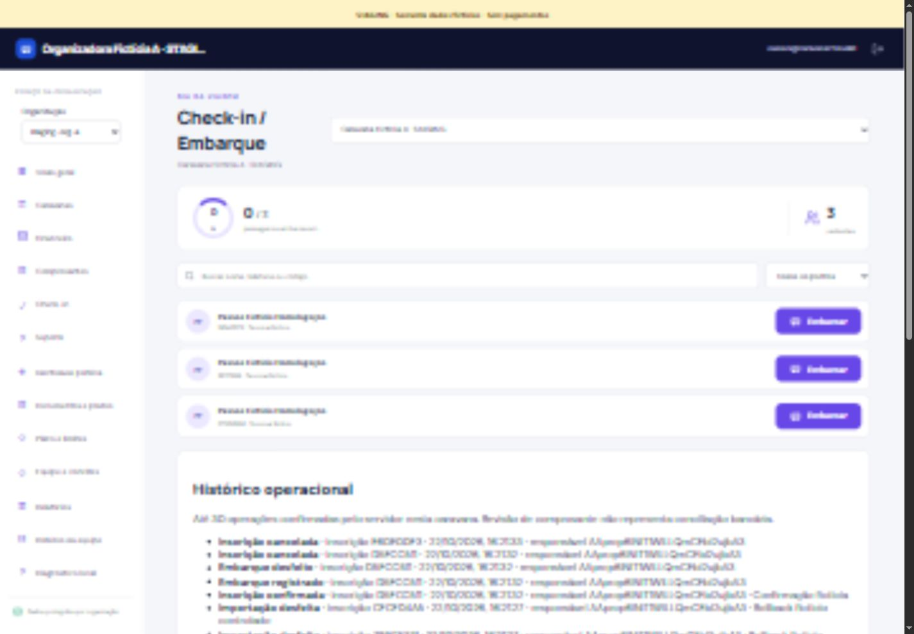

### Configuração e acessos

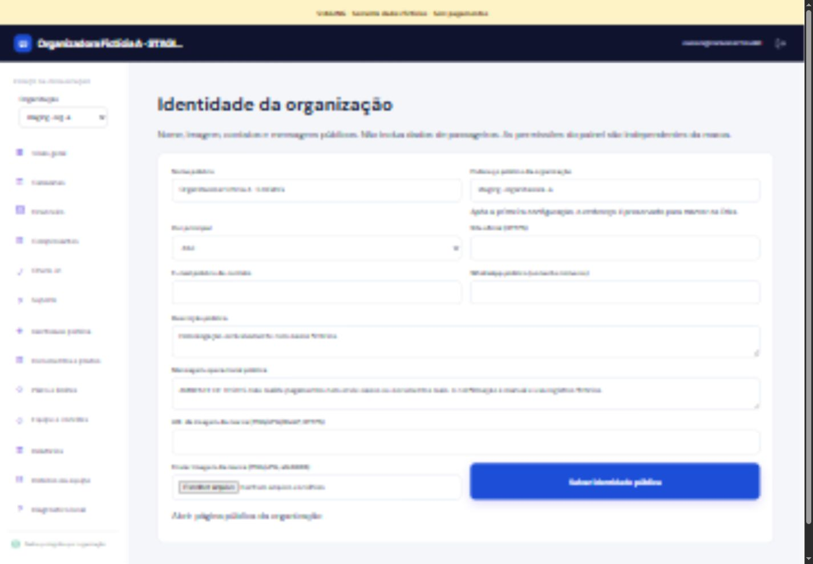

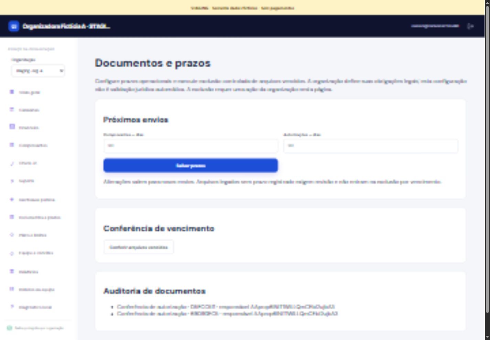

Plano e limites: [TenantCommercial.tsx](src/TenantCommercial.tsx). Sem captura nova nesta rodada.

Equipe, captura sintética histórica de20/10:

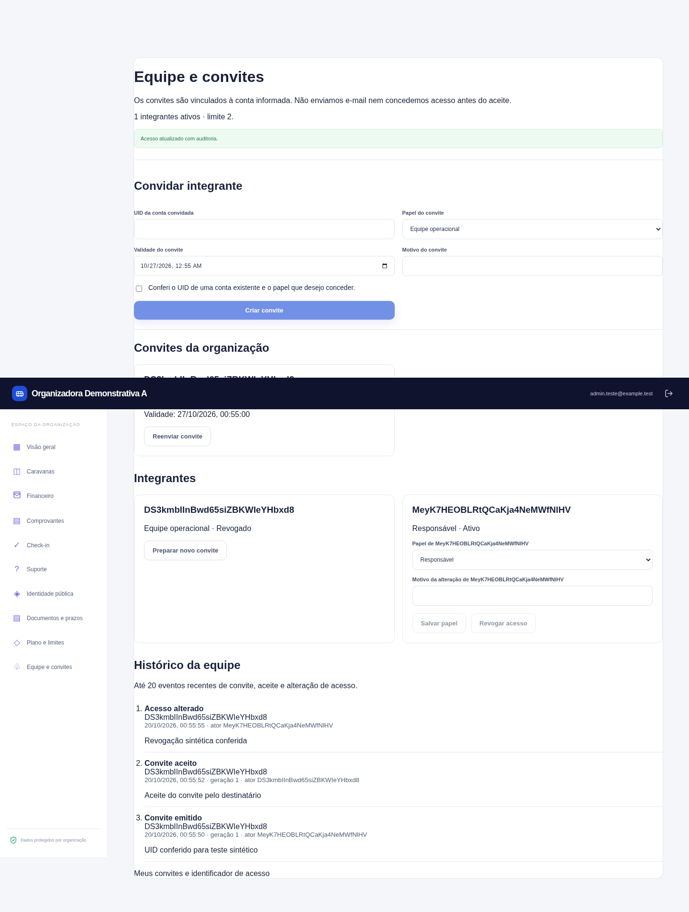

Suporte autorizado: [Support.tsx](src/Support.tsx). Sem captura nova nesta rodada.

### Relatórios, roteiros e diagnóstico

Relatórios e diagnóstico: capturas sintéticas históricas de20/10.

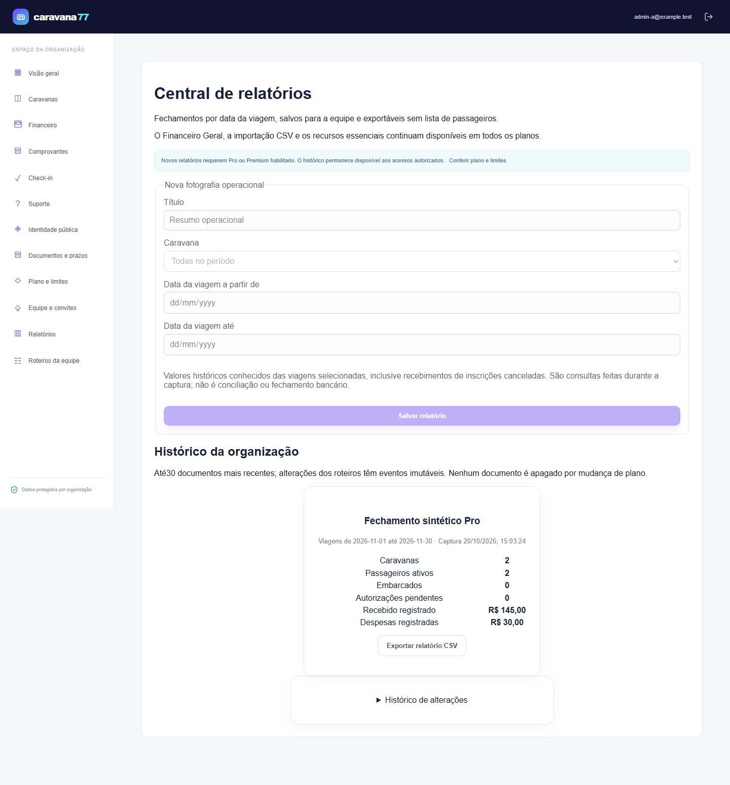

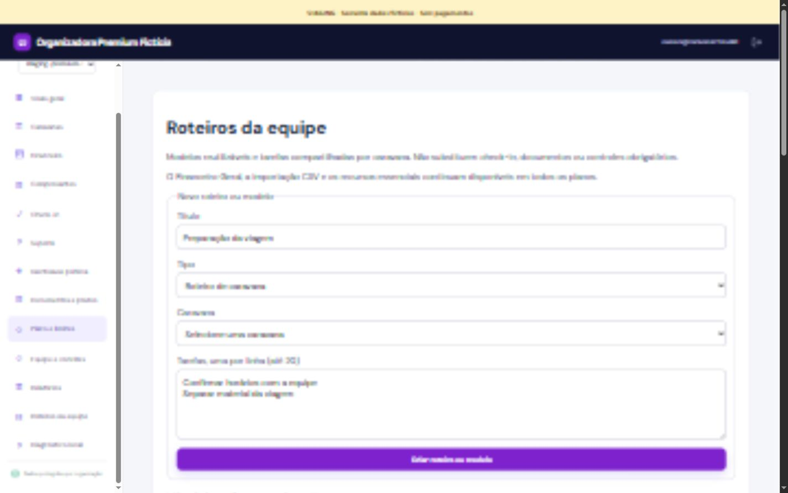

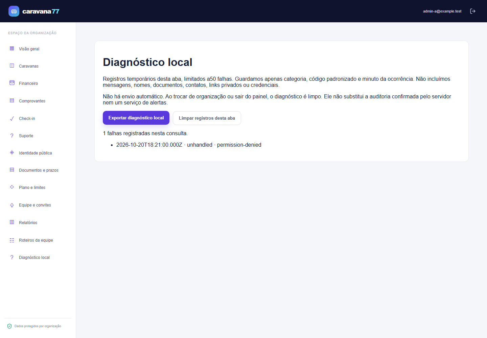

## Executar e consultar pendências

Instalação e comandos em [README.md](README.md). Execute `npm run demo` para explorar uma demonstração local com Auth/Firestore sintéticos; as contas estão em [docs/TEST_ACCOUNTS.txt](docs/TEST_ACCOUNTS.txt). Credenciais privadas do staging não são publicadas.

Estado de encerramento: [relatório de22/10](docs/MASTER_EXECUTION_2026-10-22.md), [F8](docs/F8_ACCEPTANCE.md) e [migração](docs/MIGRATION_READINESS_FINAL.md). Backup real, restauração isolada, compatibilidade legada e rollback coordenado ainda condicionam a migração. **ITALO_NOT_MIGRATED.**
