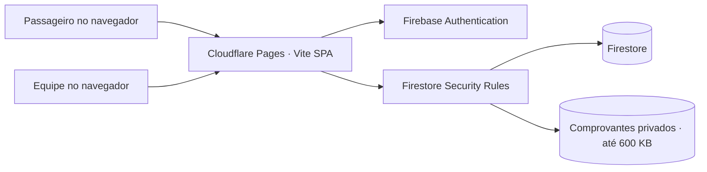

# Arquitetura

Caravana 77 é uma SPA React + TypeScript servida pelo Cloudflare Pages. Firebase Authentication identifica membros da equipe; Cloud Firestore guarda organizações, caravanas, inscrições e comprovantes privados. Não há API intermediária nem processamento de pagamentos na V1.

Os documentos `admins/{uid}` são provisionados por uma pessoa com acesso administrativo confiável ao Firebase; as regras impedem autoinscrição de administradores. Cada registro administrativo aponta para uma única organização. Consultas administrativas sempre filtram por `organizationId`.

As reservas criam um identificador aleatório de 256 bits para a inscrição e outro nonce independente. Em uma transação Firestore, o sistema incrementa `reservedSeats`, cria a inscrição privada e cria um recibo interno que vincula os dois identificadores. O documento público da caravana contém somente o nonce; as regras bloqueiam a leitura de `reservationReceipts`, então ele não revela o link privado. A reserva seguinte remove o recibo anterior da caravana. A vaga fica ocupada desde o envio do formulário até a equipe cancelar a inscrição; uma recusa permite reenviar o comprovante e não libera a vaga automaticamente. Cancelar libera uma vaga em outra transação. As regras validam a relação entre recibo, inscrição e incremento de vagas na mesma transação.

Na primeira entrada autorizada da equipe, o sistema também remove `lastReservationId` dos documentos antigos de caravanas. Essa limpeza elimina o campo legado que continha o identificador privado da última inscrição.

O comprovante fica em `registrations/{registrationId}/proofs/current`, em formato JPG/PNG/PDF e até 600 KB. A inscrição e o comprovante são atualizados em lote; as regras verificam o vínculo e só a equipe da organização pode abrir o arquivo. Um novo envio substitui o atual. A aprovação é manual; check-in exige uma sessão administrativa autorizada. Esse fluxo usa o Firestore já ativo e não exige ativar faturamento.

O financeiro é organizado por caravana. Lançar ou corrigir pagamento atualiza `paymentTotalCents` e `registrations/{registrationId}/payments/{paymentId}` na mesma transação; correções marcam o item anterior como anulado em vez de apagar o histórico. Despesas ficam em `caravans/{caravanId}/expenses/{expenseId}` e são lidas/escritas apenas pela equipe da organização proprietária. O resumo deriva valores em centavos e mantém pagamentos declarados sem valor fora dos totais conciliados.

O importador de listas anteriores valida documentos duplicados antes de salvar e reserva as vagas na mesma transação. O identificador de cada linha deriva de um ID aleatório temporário do lote e do número da linha, então reexecutar a mesma importação é idempotente sem inserir documentos pessoais no código-fonte.
