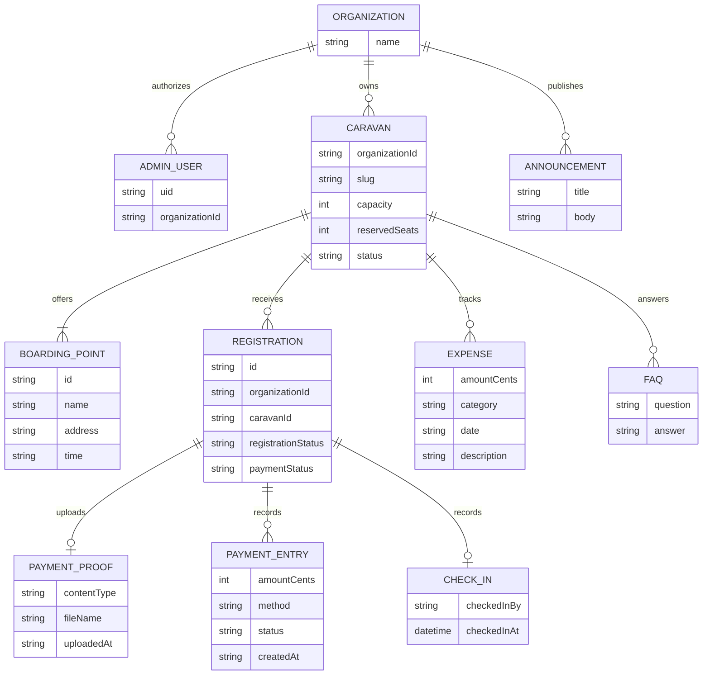

# Modelo de dados

Implementação: `admins/{uid}` liga a conta a `organizationId`; `organizations/{organizationId}` guarda metadados; `caravans/{caravanId}` guarda a caravana e os pontos/FAQ/avisos como listas ordenadas; `registrations/{registrationId}` guarda a inscrição, o total de pagamentos numéricos (`paymentTotalCents`) e os campos de check-in; `registrations/{registrationId}/proofs/current` guarda o único comprovante ativo, privado para a equipe da organização e limitado a 600 KB; `registrations/{registrationId}/payments/{paymentId}` mantém cada lançamento numérico, inclusive itens corrigidos; `caravans/{caravanId}/expenses/{expenseId}` guarda despesas da viagem. As regras verificam a organização proprietária em todas as subcoleções financeiras.

Registros importados podem conter `documentRecords` com o rótulo e o valor exatamente como foram fornecidos, sem inferir CPF/RG. `amountCents` pode ficar ausente quando o valor da viagem não foi informado. Um `paymentStatus: "reported"` com `paymentReportedMethod: "pix"` e `paymentReportedUnreconciled: true` preserva uma declaração de pagamento sem criar um lançamento monetário nem um comprovante. Esses registros não entram como recebimento conciliado.
